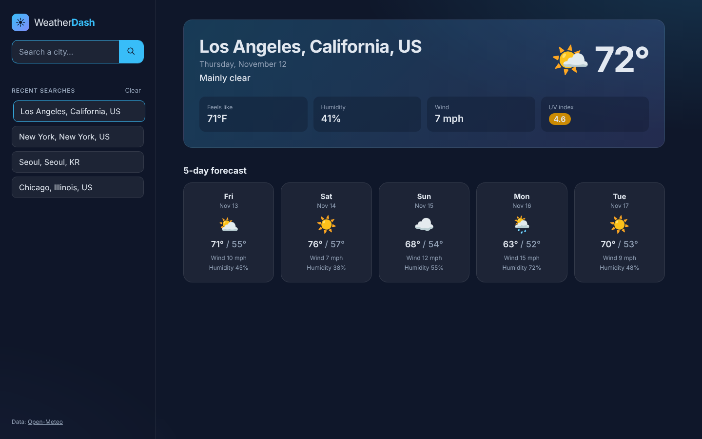

# Weather Dashboard

Search any city for current conditions and a 5-day forecast. Recent searches are saved in the browser so you can jump back to them in one click.

**Live demo:** https://jhwang2525.github.io/weather-dashboard/



## Features

- City search with automatic geocoding
- Current temperature, feels-like, humidity, wind and UV index
- UV index color-coded as low, moderate, high or severe
- 5-day forecast with highs, lows, wind and humidity
- Search history saved in `localStorage`, with a clear button
- Loading and error states, responsive layout

## Built with

- HTML, CSS and vanilla JavaScript (no frameworks)
- [Open-Meteo](https://open-meteo.com/) geocoding and forecast APIs (free, no API key required)

## Run locally

Open `index.html` in a browser, or serve the folder:

```bash
npx serve .
```
